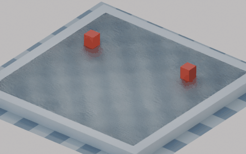

# TM2020 Material Assets Library

A material asset library for **Trackmania 2020**, designed for the **Blendermania V2 export workflow**. Browse materials in Blender's Asset Browser, apply them to your mesh, and export using their native game material links.

[](https://github.com/BigthirstyTM/TM2020-Material-Assets-Library/releases/tag/v1.0.0-materials-only)
[](https://github.com/BigthirstyTM/TM2020-Material-Assets-Library/releases/tag/v1.0.0-complete)
[](docs/INSTALLATION.md)

The badges above show the material count in each edition and the Blender version used to prepare the library. The small symbols on material thumbnails describe material features; see the [short badge legend](docs/BADGES.md).

The locally prepared full-package revision `2026.11.25-thumbnail-aspect-3` preserves image/frame proportions and fills square tiles edge to edge. It includes restored emissive sign/light previews, slightly brighter active screens, enlarged Custom sphere detail and the animation/time-step labels. Materials Only now publishes this revision. The Complete ZIP refresh is still uploading and its public downloads remain at `2026.11.24-thumbnail-styles-2` until verified promotion. See [thumbnail styles](docs/THUMBNAIL-STYLES.md).

## Current combined refresh

Content revision **2026.11.24-thumbnail-styles-2** combines the latest material improvements with the selected [A/B/C thumbnail styles](docs/THUMBNAIL-STYLES.md): softer top-down shader renders without visible studio-lamp reflections, vegetation standing on tiles, and Custom spheres. The [catalog clarity update](docs/CATALOG-CLARITY.md) removes duplicate example assets. AnimatedFlag is retained under Preview only after a reported item-loading crash; its animated MaterialLib alias is disabled.

Both full packages include the improvements to 31 projected previews, two light tubes and four optional structure colour masks, plus 88 recovered exact shader references. See [projected surfaces](docs/PROJECTED-SURFACES.md) and [source resolution](docs/SOURCE-RESOLUTION.md). The [shader reconciliation](docs/SHADER-RECONCILIATION.md) clarifies 94 root/pass references and improves ten array-based terrain previews plus LakeBottom. These source references do not promote Preview only entries to confirmed game compatibility.

## Blender 5.3 remote pilot

A [12-material Materials Only pilot](https://bigthirstytm.github.io/TM2020-Material-Assets-Library/) is now available as an asset-library extension. Materials download when needed; changed files can update independently. Experimental/Preview only entries are excluded, and MaterialLib is supplied separately through Blendermania. The full remote collection is not yet available. See [installation and update details](docs/REMOTE-LIBRARY-PILOT.md).

## Choose your edition

| Edition | Included | Recommended for |
| --- | --- | --- |
| [Materials Only](https://github.com/BigthirstyTM/TM2020-Material-Assets-Library/releases/tag/v1.0.0-materials-only) | 825 native-linked materials | Building and exporting items |
| [Complete Library](https://github.com/BigthirstyTM/TM2020-Material-Assets-Library/releases/tag/v1.0.0-complete) | All 1,119 materials, including 294 Preview only assets | Browsing the full material and texture collection |

Both editions include 20 HDRI World assets, required textures, `MaterialLib.txt`, and an offline material catalogue. Complete retains 42 source texture node groups under **Preview only / Source resources**; Materials Only omits these node-group assets. They are shader inputs, not materials to drag onto a mesh. **Choose one edition**; Complete already includes everything in Materials Only.

Each edition has **two ZIP downloads**. Extract both into the same folder for manual installation, or use the installer to download and combine them automatically.

Both editions include **animated water previews** for Stadium, BlueBay, GreenCoast, RedIsland and WhiteShore. The two-layer motion follows recovered game shader instructions, with adjustable preview speed, direction and ripple strength. Cubic height-texture filtering keeps close-up ripples smooth. See [Water animation](docs/WATER-ANIMATION.md).



The current refresh also adds water transparency in Eevee, internal ice depth and colouring, terrain angle transitions, and improved CustomGlass and parallax-screen refraction previews. See [Surface preview controls](docs/SURFACE-PREVIEWS.md) for settings and approximation limits.

The current refresh corrects native UV/vertex-colour declarations and adds source-based vertex-alpha transition layers to 14 terrain materials. Fifteen conditional ColorBlindness variants and six unsupported Warp originals now live in Complete / Preview only. See [Native material inputs](docs/NATIVE-INPUTS.md) for painting instructions and an editable example.

The combined `2026.11.23-native-surfaces-1` refresh includes the DecoHill UV overlays, depth-dependent water colour, and reconstructed WaterWall transmission, foam and animation. See [Terrain and water preview controls](docs/SHADER-FIDELITY-PREVIEWS.md) for settings and approximation limits.

It also includes the preceding 32-material Deco/PlatformIce update and another 183 corrected previews: remaining RoadDirt/ice layers, Custom Hue colour and macrodetail, native top/side texture families, GrassFence cutout, Warp screen normals and RoughMetal/specular connections. Matching thumbnails retain the existing feature badges. See [Native surface corrections](docs/CONCRETE-SHADER-CORRECTIONS.md) and [Deco and ice previews](docs/DECO-ICE-PREVIEWS.md). Check `release.json` or the installed `library.json` for the package's content revision.

Native-linked means an export link is available. It is not a blanket guarantee of in-game visibility, identical appearance, physics or crash-free behaviour. Preview only assets are reference assets with unconfirmed, conditional or unsupported export behaviour and are kept under **Trackmania2020 → 08 Preview only**. This includes vegetation previews that are not currently exportable through this library.

## Install on Windows

1. Install Blender **5.2.3 LTS or a compatible newer version** and your Blendermania build with the **V2 exporter** enabled. See [requirements](docs/INSTALLATION.md#requirements).
2. Close Blender. Open the release for your chosen edition and download **Install-Library.ps1**.
3. Open PowerShell in your download folder and run:

   ```powershell
   powershell -NoProfile -ExecutionPolicy Bypass -File .\Install-Library.ps1
   ```

The installer downloads the matching packages, checks their SHA-256 hashes, extracts the library and registers it in Blender. It also configures the Material Lib path when it can locate Blendermania. No administrator access is needed. Existing preferences and Blendermania settings are backed up before changes.

4. Start Blender, open an **Asset Browser**, and select **TM2020 Material Assets Library**.

For manual installation, custom locations, updating or uninstalling, see [Installation](docs/INSTALLATION.md). To start using materials, see [Usage](docs/USAGE.md).

## Project contents

- **GitHub repository:** installer, build tools, documentation and machine-readable material inventories.
- **Release downloads:** Blender libraries, required texture files, catalogue and installation tools. Large texture downloads are divided into ordinary ZIP packages which the installer combines automatically.
- **Offline catalogue:** open `Catalogue/index.html` inside your installed library. It includes search, categories, thumbnails and per-material usage notes.

Game assets remain the property of their respective owners. This is an independent community project. See [Credits and asset rights](docs/CREDITS.md).

For rebuilding and publishing the project, see [Maintaining](docs/MAINTAINING.md). The original installer and build tooling are covered by [LICENSE-CODE](LICENSE-CODE); this licence does not apply to game assets.
