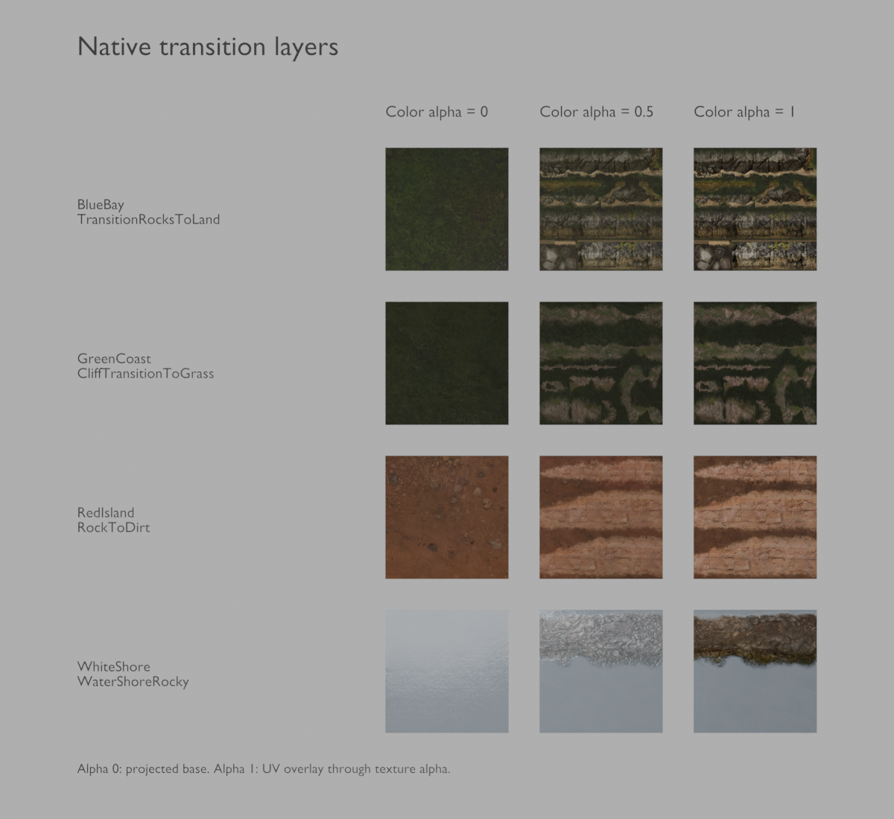

# Native material inputs

The `2026.11.23-native-inputs-1` refresh corrects export vertex declarations and adds the missing native texture layer to 14 terrain-transition previews.

## Painting transition layers

1. Add UV maps named **BaseMaterial** and **LightMap** to your mesh. The UV overlay uses BaseMaterial; the terrain base uses world projection.
2. Add a **Float Color**, **Face Corner** colour attribute named **Color**. Make it the active colour attribute for export.
3. Set or paint its **alpha** channel. Alpha **0** shows the projected base. Alpha **1** adds the overlay wherever the overlay texture has alpha. Intermediate values blend the layers. Painting RGB alone does not change this mask.
4. Export with the included `MaterialLib.txt` selected in Blendermania V2 Settings. Its `DColor0()` declarations preserve the native vertex-colour stream. A Custom material's uniform colour override is a separate feature.

Blender's brush colour picker also has an alpha value. Check the stored attribute alpha if painting seems to have no effect. Existing projects retain appended material copies: append fresh library materials after updating, and assign them to your objects.

Open **Examples/Native-Transition-Example.blend** for four editable materials at alpha 0, 0.5 and 1. Keep the example inside the installed library so its textures resolve. This is a Blender editing example; prepare your normal item collections, placement and lightmap unwrap before exporting.

The corrected preview family includes BlueBay TransitionRocksToLand and TransitionToLand; GreenCoast CliffTransition2ToGrass, CliffTransitionToGrass, LakeShoreToGrass and TransitionForestToGrass; RedIsland DetailsCliffToDirt, DetailsRocksToDirt, DetailsVegetationToDirt, RiverShoreToRiverSide and RockToDirt; WhiteShore WaterShore, WaterShoreRocky and WaterShoreToBeach.

## Projection and lightmaps

Materials that only use world projection must not receive an unnecessary BaseMaterial stream in their native declaration. For the reviewed projected families, the Lightmap declaration now uses slot 0. This includes Chraz's reported PlatformDirt_DecoCliff case. Mixed shaders retain BaseMaterial and their separate Lightmap declaration because their overlay needs mesh UVs.

Keep using the add-on's **LightMap** mesh UV name; **Lightmap** in MaterialLib is the native declaration spelling. A mesh may retain BaseMaterial even when a projected material does not export that stream.

## Complete-only references

Fifteen ColorBlindness variants and six ordinary Warp originals are retained under **08 Preview only** in Complete. Materials Only excludes them. The alternate accessibility palette is chosen by the game setting; the material link does not force it. Use the **WarpCeiling, WarpDetails, WarpGlass, WarpTechnic, WarpWall2 and WarpWall `_WithLightmap`** versions for item work.

The reference assets retain their historical native links to preserve existing projects. Their Preview-only classification means they are excluded from the recommended export set; it does not disable the export button.

## Source evidence and limits

Native `Tech3 Block PyPxz_Ids_Tex` descriptors bind terrain arrays and separate TBaseColorOp, TRoughMetal and TNormal textures. The material's VertexAlpha option selects a vertex-alpha input. Compiled `Block_PyPxz_ids_v` cache permutation 20 passes COLOR0.w and TEXCOORD0 into TEXCOORD6; compatible pixel permutation 15 samples the overlay and computes **overlay texture alpha × vertex alpha**, then blends colour, rough/metal and normal data. These matching signatures establish the family branch; they do not prove the exact permutation chosen in every game draw.

The Blender adapter uses the original overlay images and native terrain-array layer names. It decodes overlay normal XY with the recovered 1.992188 scale and -0.992188 bias. Its tangent basis, normal interpolation, existing projection weighting, scale and terrain microdetail remain renderer approximations. Runtime lighting and baked shadows have not been independently revalidated in game for this refresh.

Material thumbnails remain labelled source-image references with the existing effect symbols. Inspect the applied material or the example to see layer blending. No new customization letter badges are included.
